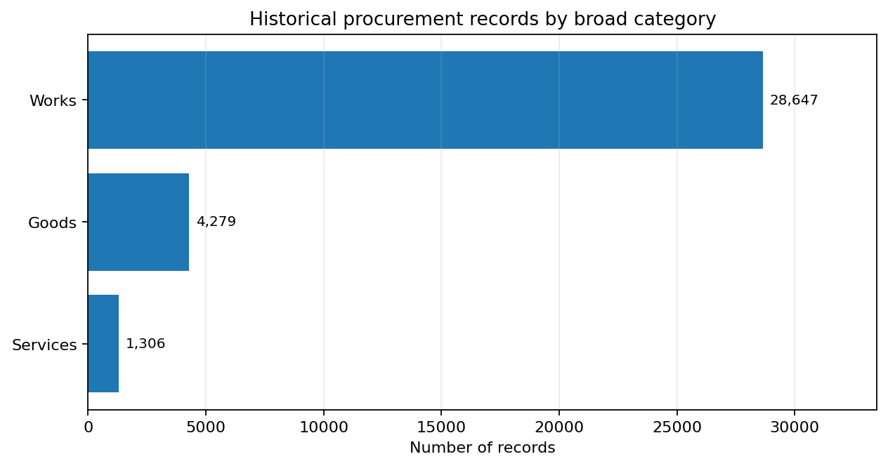
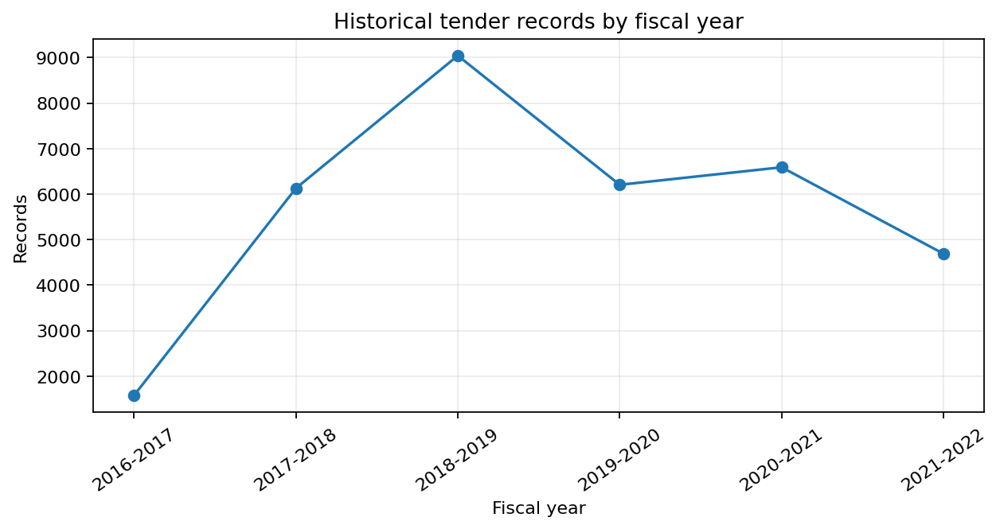

# AI-Powered Public Procurement Intelligence Platform

A reproducible Python project that combines historical procurement analytics, an ML tender-category classifier, a document-grounded tender Q&A copilot, and an explainable rule-based company Bid-Fit screen.

> **Scope note:** This is a portfolio/prototype decision-support tool. It is not an official tender portal, legal eligibility opinion, tender-win prediction model, or guaranteed-profit calculator. Historical analysis is based on an Assam dataset for FY 2016–17 to FY 2021–22. Current tender discovery/status revalidation and automatic extraction of all tender formats are not implemented.

## Repository navigation

For a map of the complete project tree and where the original cleaning, EDA, taxonomy, ML, Copilot and Bid-Fit work lives, see [`docs/PROJECT_FILE_INDEX.md`](docs/PROJECT_FILE_INDEX.md). Historical early-stage planning documents are kept under `docs/project_history/` and are clearly marked as historical.

## What the project does

### 1. Historical Procurement Market Explorer

- Audits and cleans the historical Assam public-procurement dataset.
- Profiles broad procurement categories, source classifications, buyers, recorded stages, values, fiscal years, and missingness.
- Provides interactive filters and a tender-record table in Streamlit.
- Keeps provisional niche mapping separate from the original source classification.

### 2. ML Tender Category Classifier

- Uses tender title text to classify records into `Works`, `Goods`, or `Services`.
- Pipeline: TF-IDF text features + Logistic Regression.
- Uses chronological evaluation with FY 2021–22 held out from earlier fiscal years.
- Writes metrics, per-class metrics, a confusion matrix, and row-level test predictions under `reports/ml/`.
- The score shown for a prediction is uncalibrated and is **not** a probability of eligibility, winning, or profit.

Latest recorded baseline (reproduce with the command below):

| Metric | Result |
|---|---:|
| Training rows | 29,542 |
| Held-out test rows | 4,690 |
| Accuracy | 93.35% |
| Macro F1 | 86.73% |
| Weighted F1 | 93.66% |
| Balanced accuracy | 91.55% |

These figures describe this historical Assam dataset and its source labels, not all-India performance. Some normalized tender titles repeat across years, so the holdout can still contain template similarity. See `docs/ML_BROAD_CATEGORY_CLASSIFIER.md` and `reports/ml/` for details.

### 3. AI Tender Document Copilot

- Accepts PDF tender notices and eligibility documents. Selectable text is extracted directly; scanned/image-based pages can use optional Tesseract OCR (see `docs/TENDER_SCANNED_PDF_OCR.md`).
- Extracts text page-by-page, chunks it, builds a local TF-IDF retrieval index, and finds relevant passages for the user's question.
- Displays source passages with original PDF page numbers.
- Optional OpenAI and Gemini integrations support selected AI-assisted answer-generation and tender-extraction workflows. Local retrieval and rule-based extraction provide a fallback when an API is unavailable, unconfigured, or rate-limited.
- Includes a first **Copilot-to-Bid-Fit draft handoff**: a local rule-based parser suggests common tender fields with page evidence; the user can review/edit the draft and send it to the Bid-Fit page for prefill. This field extraction does not require an LLM API.
- Uses `assets/demo_synthetic_tender_notice.pdf` for local testing. This is a fictional demo, not a real tender.

OCR is optional and depends on Tesseract and the project OCR dependencies. OCR output can contain recognition errors; verify extracted clauses against the original PDF. AI-generated answers can be wrong and must be checked against cited evidence. Provider-backed workflows may send relevant prompts and document excerpts to the configured provider. Do not upload confidential documents unless authorised.

### 4. Company Bid-Fit Analysis

- Compares a user-entered company profile against tender requirements.
- Provides an explainable, criterion-by-criterion score and one of `POTENTIAL BID`, `MANUAL REVIEW`, or `NO-BID`.
- Missing/unverified information routes to `MANUAL REVIEW`; a hard fail should only drive `NO-BID` when the user has confirmed the profile, reviewed the mandatory requirements, and checked the official source.
- Score is a rule-based fit score for entered fields. It is **not** a win probability and does not prove profitability.

Current limitation: Copilot can prefill a reviewed draft of some tender fields, but unsupported/missing fields remain blank and must be entered manually. The Bid-Fit engine does not verify that the uploaded PDF is official, confirm current portal status, calculate profit, or submit bids.

## Power BI Market Intelligence Dashboard

The repository includes both the Power BI report and its editable project source.

- Ready-to-open report: [`Public_Procurement_Market_Intelligence.pbix`](powerbi/exports/Public_Procurement_Market_Intelligence.pbix)
- Editable PBIP project: [`Power BI project folder`](powerbi/Public_Procurement_Market_Intelligence/)
- The PBIP source includes report definitions, semantic model definitions, and project documentation.
- Machine-specific `.pbi` cache files are excluded from version control.
## Historical dataset snapshot

| Item | Latest audited result |
|---|---:|
| Historical records | 34,232 |
| Original source columns | 34 |
| Analytical columns after cleaning | 21 |
| Unique OCIDs | 34,232 |
| Duplicate OCID rows | 0 |
| Broad source categories | Works: 28,647; Goods: 4,279; Services: 1,306 |
| Detailed original classifications | 89 |
| Tender-value field | 30,242 positive; 2,410 zero; 1,580 missing/non-numeric |
| Provisional taxonomy | Rule-based analytical mapping; labels remain provisional and require review |
| Records flagged for review | 2,974 |

Taxonomy mapping coverage is not classification accuracy. Currency/unit of reported tender values has not been independently verified, and tender value is not supplier revenue or profit.

## Visual snapshot

### Historical procurement activity by category



### Historical tender records by fiscal year


## Run locally (Windows PowerShell)

Python 3.11 is the recommended environment.

```powershell
# From the repository root
py -3.11 -m venv .venv
.\.venv\Scripts\Activate.ps1
python -m pip install -r requirements.txt

# Optional: Gemini API integration
python -m pip install -r requirements-gemini.txt

# Optional: scanned PDF OCR
python -m pip install -r requirements-ocr.txt

# Tesseract OCR desktop software must also be installed separately.

# Rebuild historical procurement analysis
python src/check_environment.py
python src/audit_assam_procurement.py
python src/clean_assam_procurement.py
python src/profile_procurement_categories.py
python src/run_procurement_eda.py
python src/review_niche_taxonomy.py
python src/prepare_taxonomy_signoff.py
python src/audit_source_classification_consistency.py
python src/audit_taxonomy_workbook.py
python src/analyze_procurement_business.py
python src/validate_business_analysis_outputs.py
# Run tests
python -m pytest tests -q

# Train/recreate the broad-category model and its reports
python src/train_procurement_category_model.py

# Launch all Streamlit pages
python -m streamlit run app/market_explorer.py
```

Streamlit opens a local address, normally `http://localhost:8501`. The app navigation contains the Historical Market Explorer, ML Tender Category Classifier, AI Tender Document Copilot, and Company Bid-Fit Analysis pages.

Latest local verification: **210 tests passed** (`python -m pytest tests -q`). Re-run the suite after changes.

### Optional: Enable LLM-generated answers

1. Copy `.env.example` to `.env` in the project root.
2. Configure `OPENAI_API_KEY` and/or `GEMINI_API_KEY` as required by the selected workflow. Set the corresponding model variables to models available to your API account.
3. Restart Streamlit.
4. Never commit `.env` or publish secrets. API calls can incur costs. Local PDF extraction and evidence retrieval still work without an API key.

## Repository layout

```text
app/
  market_explorer.py                 # Main Streamlit app and historical dashboard
  market_explorer_data.py            # Dashboard data loading/filtering
  category_prediction.py             # ML prediction helper
  tender_copilot.py                  # PDF extraction, retrieval, optional LLM answer
  tender_requirements_extractor.py   # Conservative rule-based draft extraction with page evidence
  bid_fit_engine.py                  # Explainable rule-based Bid-Fit logic
  pages/                             # ML, Copilot, and Bid-Fit pages
src/                                  # Audits, data cleaning, EDA, ML training scripts
data/raw/                            # Original source ZIP
data/processed/                     # Cleaned analytical dataset
reports/                              # EDA, validation, business analysis, ML results
docs/                                 # Methodology, limitations, module details
assets/                               # Charts and fictional demo PDF
tests/                                # Regression, ML-helper, copilot and Bid-Fit tests
requirements.txt
```

## Technology stack

| Area | Technologies |
|---|---|
| Language | Python 3.11 |
| Data processing | Pandas, NumPy |
| Machine learning | Scikit-learn, TF-IDF, Logistic Regression |
| Visualization | Plotly |
| Web application | Streamlit |
| Document processing | PyMuPDF, pypdf |
| OCR | Tesseract OCR (optional) |
| AI integration | OpenAI API, Google Gemini API (optional) |
| Testing | Pytest |
| Business intelligence | Microsoft Power BI, PBIP, PBIX |
| Version control | Git and GitHub |
## Source and attribution

Historical source: Assam Public Procurement Data, published through India's Open Government Data Platform.

- Dataset catalog: https://www.data.gov.in/catalog/assam-public-procurement-data
- Government Open Data License - India: https://data.gov.in/Godl
- OGD terms: https://www.data.gov.in/terms-of-use
- Official Assam tender portal: https://assamtenders.gov.in/nicgep/app

Attribution: “Source: Assam Public Procurement Data, OGD Platform India / Assam Finance Department, https://www.data.gov.in/catalog/assam-public-procurement-data. License: Government Open Data License - India, https://data.gov.in/Godl.”

The code's MIT license does not replace the dataset's separate license. Review source terms before redistributing third-party data.

## Known limitations and future work

- No repeatable live/current tender feed or automated corrigendum/status refresh.
- The Copilot-to-Bid-Fit extractor is regex/rule based and only recognises a limited set of common field patterns; all candidates require user review.
- Current tender status/corrigenda are not automatically checked, and official source URLs must be entered manually.
- Taxonomy labels are provisional; classification accuracy requires further representative human review.
- The ML model classifies broad procurement type only; it does not predict niche correctness, bid outcomes, eligibility or profitability.
- No company-wise bid history, awarded-bid data, supplier cost structure, or validated margin targets are available for win/profit prediction.
- Advanced table/BOQ parsing, multi-document comparison, user accounts, persistent database and arbitrary-portal adapters remain future extensions.

The immediate design priority is reliability and transparent evidence, not adding features just to increase project size.

## Author

**Ayush Raj** · B.Tech CSE (Data Science & ML), Lovely Professional University

- GitHub: https://github.com/ayush13122
- LinkedIn: https://www.linkedin.com/in/ayush-raj-331a8228a
