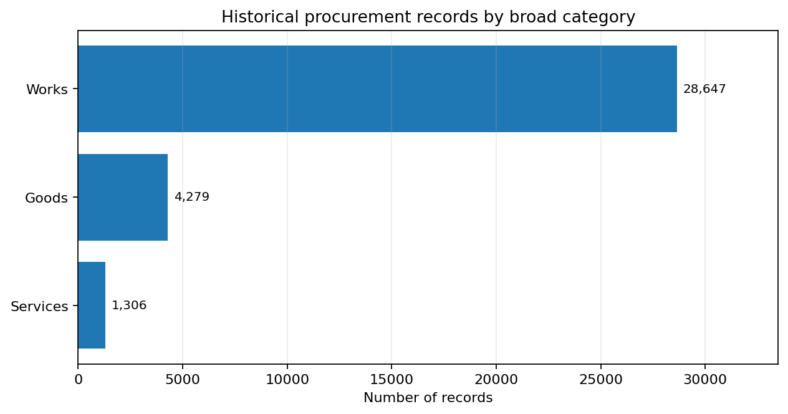
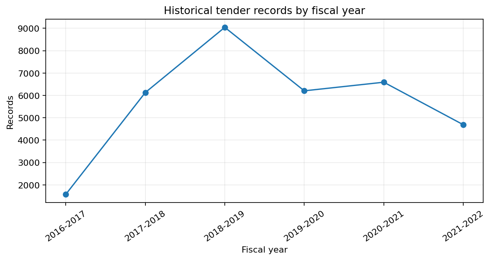

# Public Procurement Opportunity Intelligence & Bid Strategy Analysis

**A reproducible Python project for exploring historical public procurement data, profiling buyers and categories, and building a transparent foundation for supplier opportunity screening.**

> **Project status (honest scope):** Historical data audit, cleaning, category profiling, exploratory/business analysis, taxonomy review workflow, automated checks, and report validation are implemented. A historical Streamlit Market Explorer is included. A live/current-tender ingestion pipeline, final human-approved taxonomy, and company-profile bid-fit engine are **not yet implemented** in this repository version.

## Why this project?

B2B suppliers often face many procurement notices and need a structured way to understand which categories and buyer organizations appear frequently. This project turns a historical Assam procurement dataset into repeatable analytical outputs so a business-development team can explore recorded activity, inspect missingness and category quality, and form evidence-backed hypotheses for further research.

It is a decision-support analysis project—not an automated bid submission system and not a model that predicts tender wins.

## Key dataset and pipeline facts

| Item | Result from the current run |
|---|---:|
| Historical procurement records | 34,232 |
| Original source columns | 34 |
| Analytical columns after cleaning | 21 |
| Unique OCIDs | 34,232 |
| Duplicate OCID rows | 0 |
| Broad procurement categories | 3: Works, Goods, Services |
| Detailed source classifications | 89 |
| Original categories with most records | Works: 28,647 (83.68%) |
| Tender value data | 30,242 positive; 2,410 zero; 1,580 missing/non-numeric |
| Current taxonomy | Provisional, with records explicitly flagged for review |
| Automated validation | 42 project tests passed; 8 business-report comparisons passed in the prepared run |

The 2016–17 to 2021–22 dataset is **Assam-specific and historical**. Its category distribution must not be generalized to all Indian procurement. A reported tender value is not profit, and historical records are not currently open opportunities.

## What is implemented?

1. **Source audit** — inspects the six CSV files in the source ZIP, schemas, year coverage, column quality, and keyword candidates.
2. **Data cleaning** — preserves all 34,232 source rows, removes repeated/constant metadata from the analytical table, standardizes missing-value handling, parses numeric tender values, and writes a cleaned CSV plus quality reports.
3. **Category profiling & provisional niche mapping** — retains the original broad category and source classification while suggesting broader analytical niches. Specific title rules are guarded by regression tests; ambiguous records remain reviewable.
4. **Exploratory data analysis** — profiles categories, classifications, publication dates, tender values, stages, bidder counts, buyers, and missingness; creates CSV reports and interactive Plotly HTML charts.
5. **Taxonomy review pack** — creates review queues and an Excel sign-off workbook. Suggestions are explicitly not treated as ground truth until reviewed.
6. **Source consistency audit** — joins original source records with niche assignments via OCID and checks source/assignment field consistency.
7. **Business analysis** — creates broad-category, provisional-niche, fiscal-year, buyer, tender-stage and source-classification crosswalk reports.
8. **Report validation** — compares latest analysis outputs with underlying data and checks key-level count consistency.
9. **Automated tests** — regression tests cover data and taxonomy helper logic, sample classifications, report consistency, and the Market Explorer data-loading/filtering functions.
10. **Historical Market Explorer dashboard** — a Streamlit app lets users filter historical tenders by procurement type, provisional niche, fiscal year, stage, buyer, title, and reported value; view summaries/charts; and export filtered rows as CSV.

## Selected findings

- The broad category distribution is highly imbalanced toward **Works**: 28,647 records, compared with 4,279 Goods and 1,306 Services.
- `tender/documents/id` is missing for about 99.6% of records in the cleaned snapshot, limiting document-level eligibility analysis from this file alone.
- Tender value should be treated carefully: zeros and missing values are separate groups, and the available field does not provide supplier costs or profit.
- Initial keyword mapping produced false positives (for example, word fragments inside unrelated words), so rules were refined and regression tests added.
- At the latest observed run, source-classification-based assignments, title-keyword candidates and unresolved cases were kept distinct. Exact counts can change if taxonomy rules change; rerun the scripts to regenerate current reports.

## Visual snapshot

### Procurement activity by broad category



### Recorded tenders by fiscal year



These figures describe the historical Assam extract only; they are not a current opportunity count or India-wide market estimate.

## Technology stack

- **Python 3.11**
- **Pandas, NumPy** — data profiling and cleaning
- **Plotly** — interactive analytical charts
- **Streamlit** — historical Market Explorer dashboard
- **openpyxl** — review workbook generation
- **pytest** — regression and validation tests
- **Git/GitHub** — version control and portfolio publication

## Repository structure

```text
.
├── data/
│   ├── raw/                 # Original source ZIP
│   ├── processed/           # Reproducible cleaned CSV generated by scripts
│   └── metadata/            # Source register and license/provenance details
├── docs/                    # Methodology, decisions, limitations, interview notes
├── reports/                 # Generated audit, EDA, taxonomy, and business outputs
├── src/                     # All reproducible Python scripts
├── tests/                   # Regression and output validation tests
├── assets/                  # Lightweight visual summary for the README
├── app/                     # Streamlit Market Explorer app and data helpers
├── requirements.txt
└── README.md
```

## Run it locally (Windows PowerShell)

Python 3.11 is recommended for the reproduced environment.

```powershell
# 1) Create and activate a virtual environment
py -3.11 -m venv .venv
.\.venv\Scripts\Activate.ps1

# 2) Install dependencies
python -m pip install -r requirements.txt

# 3) Verify environment
python src/check_environment.py

# 4) Audit source archive
python src/audit_assam_procurement.py

# 5) Clean and profile records
python src/clean_assam_procurement.py
python src/profile_procurement_categories.py

# 6) Generate EDA and taxonomy review outputs
python src/run_procurement_eda.py
python src/review_niche_taxonomy.py
python src/prepare_taxonomy_signoff.py
python src/audit_source_classification_consistency.py
python src/audit_taxonomy_workbook.py

# 7) Generate business analysis and validate report outputs
python src/analyze_procurement_business.py
python src/validate_business_analysis_outputs.py

# 8) Run tests
python -m pytest tests -q

# 9) Launch the historical Market Explorer
python -m streamlit run app/market_explorer.py
```

If Excel is open on `reports/taxonomy_review/Taxonomy_Review_Workbook.xlsx`, close it before regenerating the workbook, otherwise Windows may return `PermissionError`.

## Run the Streamlit Market Explorer

From the repository root, install the dependencies and launch the app:

```powershell
python -m pip install -r requirements.txt
python -m streamlit run app/market_explorer.py
```

The dashboard is historical-only. It does not show current open tenders and does not predict profit or win probability. Niche assignments are provisional.

### Deploy with Streamlit Community Cloud

1. Push the `app/` folder and the updated `requirements.txt` to this public GitHub repository.
2. Sign in at https://share.streamlit.io and connect GitHub if prompted.
3. Click **Create app** and select repository `ayush13122/public-procurement-opportunity-intelligence`, branch `main`, and entrypoint `app/market_explorer.py`.
4. In **Advanced settings**, select Python 3.11 to match the locally tested environment.
5. Click **Deploy**. After the app launches, add its generated `https://...streamlit.app` URL here and to the project README link near the top.

**Live demo:** Deployment pending.

## Data source and attribution

**Source:** Assam Public Procurement Data, published through the Government of India's Open Government Data (OGD) Platform. The catalog describes procurement data for different years in Assam and links it to the Assam tender system.

- Dataset catalog: https://www.data.gov.in/catalog/assam-public-procurement-data
- Government Open Data License - India: https://data.gov.in/Godl
- OGD terms of use: https://www.data.gov.in/terms-of-use

**Attribution statement:** “Source: Assam Public Procurement Data, OGD Platform India / Assam Finance Department, https://www.data.gov.in/catalog/assam-public-procurement-data. License: Government Open Data License - India, https://data.gov.in/Godl.”

The dataset is included for reproducibility with this attribution. The code's MIT license does not replace the dataset's separate license. Check the dataset metadata/conditions before redistributing any updated or third-party materials.

## Limitations and careful interpretation

- **Historical snapshot only:** data spans FY 2016–17 to FY 2021–22 and is not an active tender feed.
- **Taxonomy is provisional:** source categories and titles can conflict. Mapped niches are suggestions for analysis and are not verified ground truth.
- **No live/current data integration yet:** active/archived portal searches were manually explored during feasibility testing, but no repeatable live feed is included in this release. The Streamlit app only explores the historical Assam snapshot.
- **No win-probability claim:** there is no validated model here that estimates the probability of winning a tender.
- **No profit prediction:** tender value does not account for delivery cost, bid price, taxes, EMD, overhead, or supplier capacity.
- **Incomplete tender documents:** the cleaned source has very high missingness in the document ID field; eligibility must be verified from original tender documents.
- **Coverage bias:** conclusions describe this Assam dataset, not all states or all procurement in India.

## Roadmap (not claimed as complete)

- Human review and approval of the provisional taxonomy
- Collect and document a bounded set of current tenders from permitted public listings/manual downloads
- Add company profile inputs and transparent Bid / No-Bid / Manual Review logic
- Collect and document a bounded set of current tenders from permitted public listings/manual downloads
- Add company profile inputs and transparent Bid / No-Bid / Manual Review logic

## Publish this project to GitHub

1. Create an empty public repository named `public-procurement-opportunity-intelligence` under the GitHub account linked in the CV. Do not initialize it with another README or license because this folder already contains both.
2. Extract/open this folder on your Windows machine and run the commands below from the repository root.

```powershell
git init -b main
git add .
git commit -m "Add historical procurement analysis pipeline"
git remote add origin https://github.com/ayush13122/public-procurement-opportunity-intelligence.git
git push -u origin main
```

GitHub will ask you to authenticate if your credentials are not already configured. Only the public repository URL becomes valid after you create the remote repository and push successfully.

## Author

**Ayush Raj** · B.Tech CSE (Data Science & ML), Lovely Professional University

- GitHub: https://github.com/ayush13122
- LinkedIn: https://www.linkedin.com/in/ayush-raj-331a8228a
